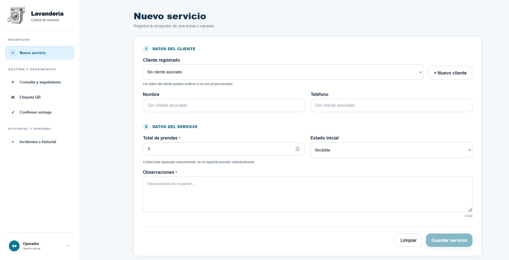

# Lavado y Secado — Sistema de control de lavandería

Sistema web interno para gestionar servicios de lavandería por **bolsa o canasto**, desde la recepción hasta la entrega al cliente. La solución identifica cada servicio mediante un código QR único, controla su estado, registra operaciones relevantes y ayuda a prevenir entregas equivocadas.

<p align="center">
  
</p>

## Funcionalidades principales

- Autenticación con sesión en cookie `HttpOnly`.
- Acceso diferenciado para `OPERADOR` y `PROPIETARIO`.
- Registro y consulta de clientes.
- Registro de servicios por bolsa o canasto.
- Seguimiento del estado del servicio.
- Generación e impresión de etiquetas QR.
- Lectura de QR mediante cámara.
- Validación del QR antes de confirmar una entrega.
- Registro de incidencias y correcciones.
- Historial cronológico de operaciones.
- Consulta mensual de entregas para el propietario.
- Administración de cuentas de operadores.
- Interfaz responsive para escritorio, tablet y móvil.

## Flujo del servicio

```text
Recepción
   ↓
RECIBIDA
   ↓
EN_PROCESO
   ↓
LISTA_PARA_RECOGER
   ↓
Validación del QR
   ↓
ENTREGADA
```

La transición a `ENTREGADA` solo puede realizarse desde el módulo de confirmación de entrega y requiere validar el QR correspondiente al servicio.

## Roles

### Operador

Gestiona la operación diaria de la lavandería:

- clientes;
- nuevos servicios;
- seguimiento;
- etiquetas QR;
- confirmación de entregas;
- incidencias e historial.

### Propietario

Dispone de funciones administrativas:

- consulta mensual de entregas;
- creación y administración de operadores;
- activación y desactivación de cuentas;
- cambio de contraseñas de operadores.

## Tecnologías

| Capa | Tecnologías |
| --- | --- |
| Frontend | React, Vite, TypeScript, React Router, CSS |
| QR | `qrcode.react`, `@zxing/browser` |
| Backend | Node.js, Express, TypeScript, Zod |
| ORM | Prisma |
| Base de datos | MySQL 8.4 |
| Servidor web | Nginx |
| Contenedores | Docker / Docker Compose para desarrollo local |
| Producción | Railway |

## Arquitectura

```text
Navegador
   ↓ HTTPS
Frontend React + Nginx
   ↓ /api
Backend Node.js + Express
   ↓ Prisma ORM
MySQL
```

El frontend utiliza rutas relativas `/api`. En producción, Nginx reenvía estas solicitudes al backend dentro de la red privada de Railway.

## Estructura del proyecto

```text
lavanderia/
├── backend/
│   ├── prisma/
│   ├── scripts/
│   └── src/
│       ├── config/
│       ├── lib/
│       ├── middleware/
│       └── modules/
├── frontend/
│   └── src/
│       ├── assets/
│       ├── components/
│       ├── hooks/
│       ├── layout/
│       ├── pages/
│       ├── services/
│       ├── styles/
│       ├── types/
│       └── utils/
├── docs/
│   └── images/
├── docker-compose.yml
└── README.md
```

## Ejecución local

### Requisitos

- Node.js 24 o superior.
- npm.
- MySQL 8.4 o compatible.
- Git.

Instala las dependencias desde la raíz:

```bash
npm run install:all
```

Crea `backend/.env` a partir de las variables documentadas en `.env.example`. No almacenes credenciales reales en el repositorio.

Genera Prisma Client y aplica las migraciones correspondientes al entorno:

```bash
npm --prefix backend run db:generate
```

Levanta backend y frontend en terminales separadas:

```bash
npm run dev:backend
```

```bash
npm run dev:frontend
```

## Verificación antes de integrar cambios

```bash
npm run check
npm test
npm run build
```

Además de las verificaciones automáticas, deben probarse manualmente el inicio de sesión, el registro de servicios, el seguimiento, la impresión y lectura del QR, la confirmación de entrega y el historial.

## Seguridad

El sistema aplica, entre otras, las siguientes medidas:

- contraseñas almacenadas mediante hash;
- cookies de sesión `HttpOnly`;
- autorización validada en backend;
- validación de datos con Zod;
- QR sin datos personales del cliente;
- secretos y credenciales mediante variables de entorno;
- bitácora de operaciones relevantes;
- HTTPS en producción.

Los archivos `.env`, contraseñas, tokens, cookies y credenciales de base de datos no deben versionarse.

## Estado de integraciones

**Cámara QR:** implementada mediante el navegador con `@zxing/browser`.

**Impresión:** la etiqueta puede imprimirse desde el navegador y está preparada para lectura física mediante QR. La integración directa con una impresora térmica puede incorporarse posteriormente sin modificar el flujo principal del servicio.

**Notificaciones:** el sistema puede registrar notificaciones pendientes cuando un servicio queda listo para recoger. La integración con un proveedor externo de WhatsApp se mantiene desacoplada del flujo principal.

## Objetivo

Mantener identificada cada bolsa o canasto desde su recepción hasta su entrega, reducir errores de identificación y conservar trazabilidad sobre las acciones realizadas durante el servicio.
